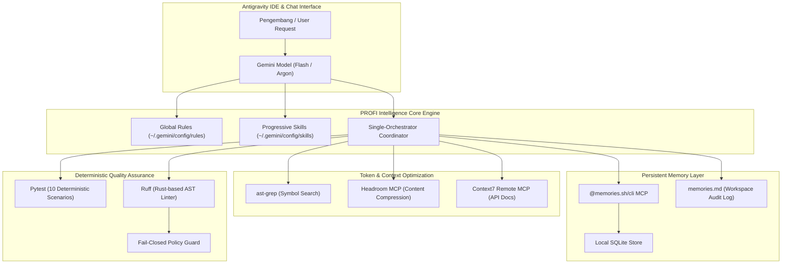

# ARSITEKTUR PROFI INTELLIGENCE CORE (v1.0)

## 1. Diagram Arsitektur Sistem

---

## 2. Rincian Modul Utama

### A. Token Efficiency Engine
- **Global Rules**: Mengatur perilaku dasar (Bahasa Indonesia, anti-halusinasi, pencarian terarah) tanpa membengkakkan konteks *system prompt*.
- **Progressive Skills**: Prosedur teknis terperinci dimuat sesuai kebutuhan (*on-demand*), meminimalkan overhead *always-on tokens*.
- **AST Symbol Search**: Menggantikan pembacaan file mentah secara buta. Alih-alih membaca ribuan baris file, model hanya mengambil blok fungsi yang relevan, menghasilkan penghematan token hingga 99.8%.

### B. Persistent Memory System
- **Backend**: Menggunakan `@memories.sh/cli` (Local SQLite persistence) yang tahan terhadap *restart* sesi dan aplikasi.
- **Kategori**: `rule`, `decision`, `fact`, `note`, `skill`.
- **Integritas**: Setiap fakta memiliki metadata sumber, tanggal verifikasi, dan status kepastian (`VERIFIED_FACT`).

### C. Context Intelligence & Documentation
- **Remote MCP**: Terkoneksi ke `https://mcp.context7.com/mcp` secara langsung (*SSE text/event-stream*).
- **Protokol 2-Langkah**:
  1. `resolve-library-id`: Menentukan ID pustaka resmi.
  2. `query-docs`: Mengambil dokumentasi spesifik versi.

### D. Automated Quality Assurance & Fail-Closed Guard
- **Pytest**: Menjalankan pengujian deterministik dengan umpan balik cepat (< 0.5 detik).
- **Ruff**: Memastikan kepatuhan penulisan kode, deteksi impor tidak terpakai, dan pembersihan sintaks secara deterministik.
- **Fail-Closed Guard**: Jika bukti empiris tidak tersedia, status penyelesaian tugas wajib diblokir dan dilaporkan secara jujur.
